# UniFi SiteThread for Omarchy (BoeyCorp Fork)

UniFi SiteThread is a high-density, NOC-style UniFi Network and Protect operations cockpit for the Omarchy top bar. It aggregates every site owned by (or shared with) your UI Account into one popup and a seven-tab fleet analytics window, using only live data from the UniFi APIs.

> Screenshots below have names, IP/MAC addresses, SSIDs, passphrases and other identifying data blurred.

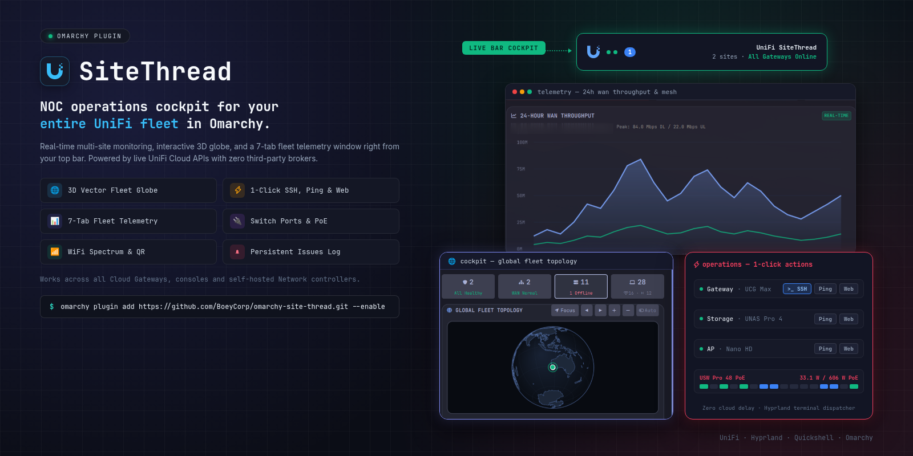


## Contents

- [Visual tour](#visual-tour)
- [Features](#features)
- [Security model](#security-model)
- [Install](#install)
- [Dependencies](#dependencies)
- [Connect](#connect)
- [Keyboard shortcuts](#keyboard-shortcuts)
- [IPC reference](#ipc-reference)
- [Update / Remove](#update--remove)
- [Development](#development)
- [Roadmap](#roadmap)
- [License](#license)

## Visual tour

### Bar popup

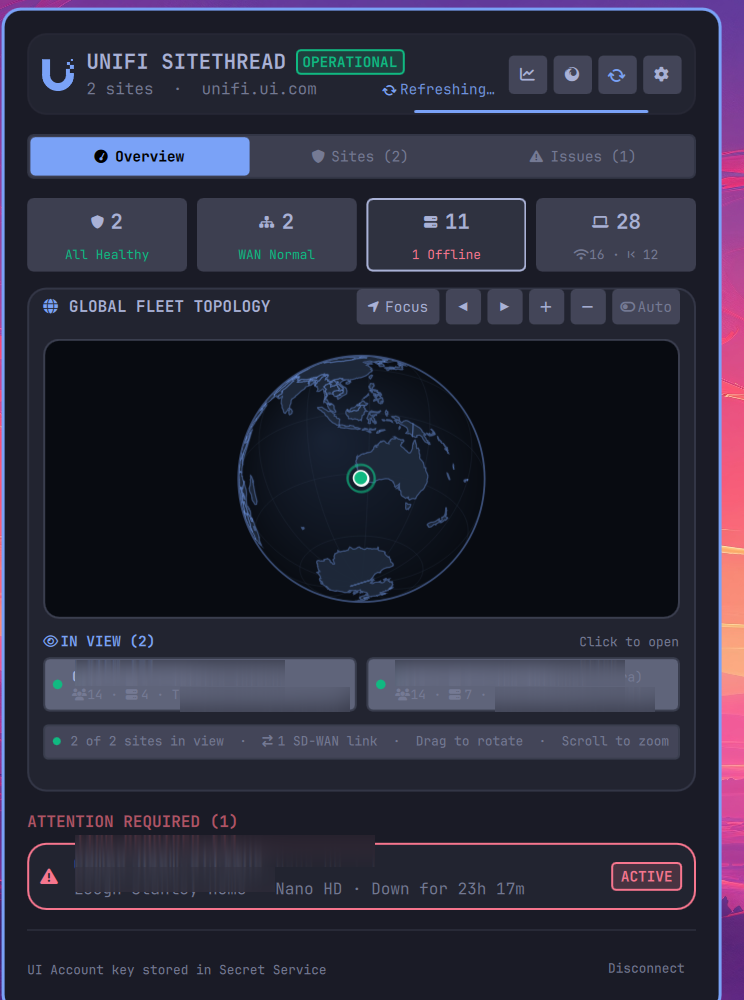
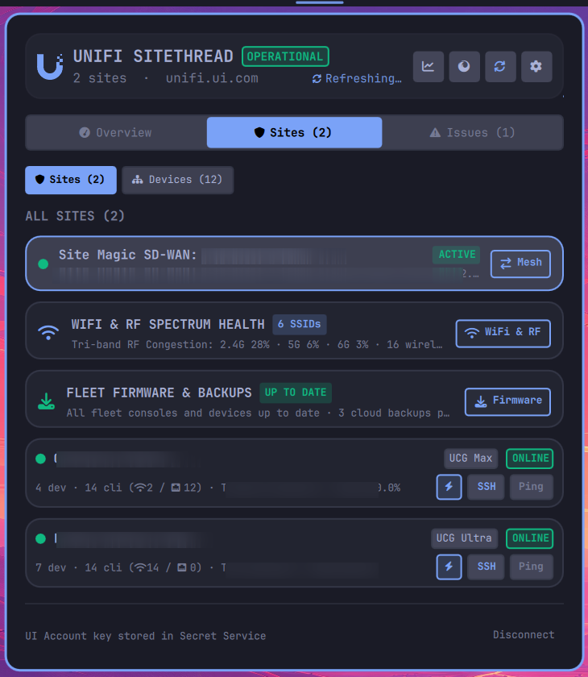
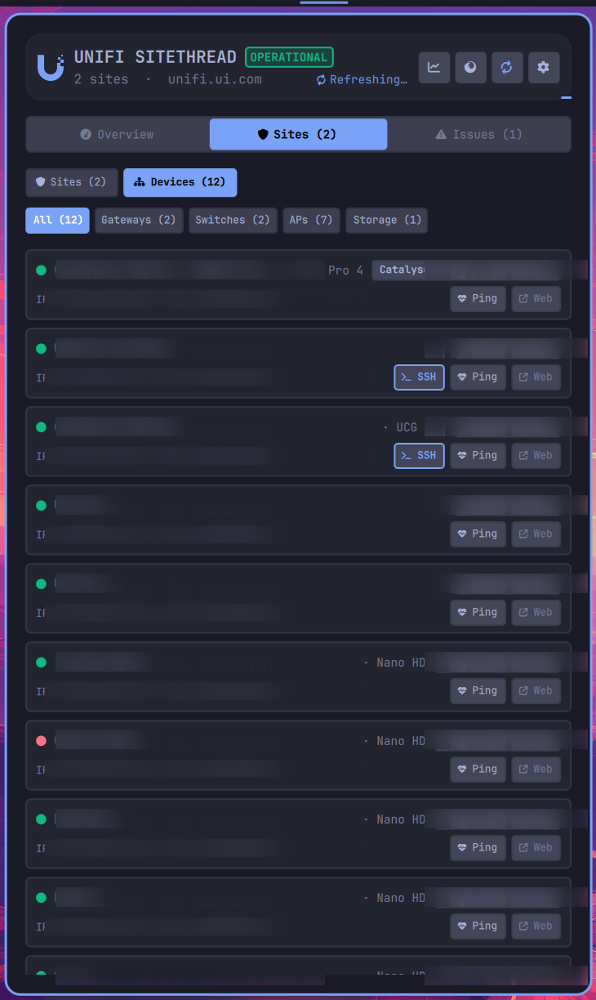
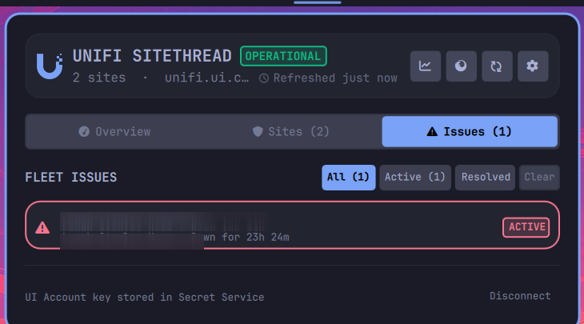
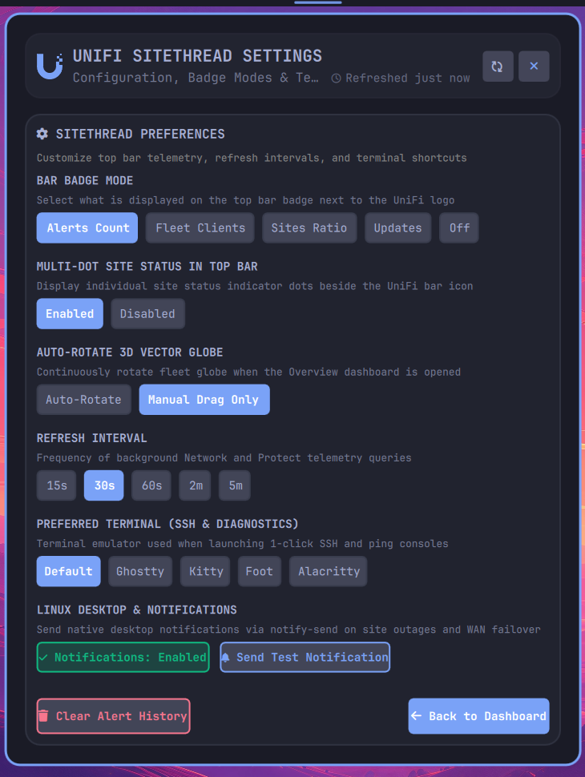

### Fleet Analytics & Telemetry window

**1. Overview & Mesh** – 24-hour WAN throughput, client density by band, Site Magic SD-WAN, managed site matrix.

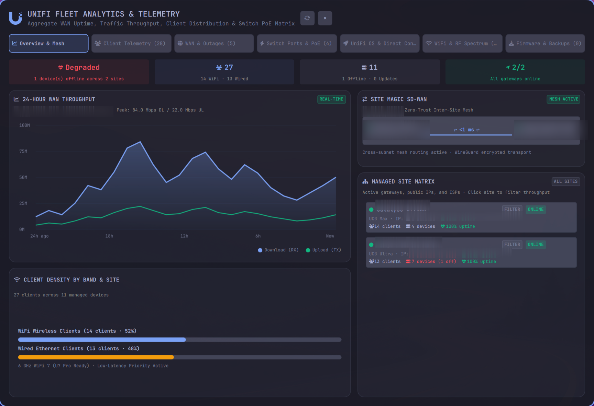

**2. Client Telemetry** – searchable wired/WiFi client roster with uplink, signal, protocol, traffic and uptime.

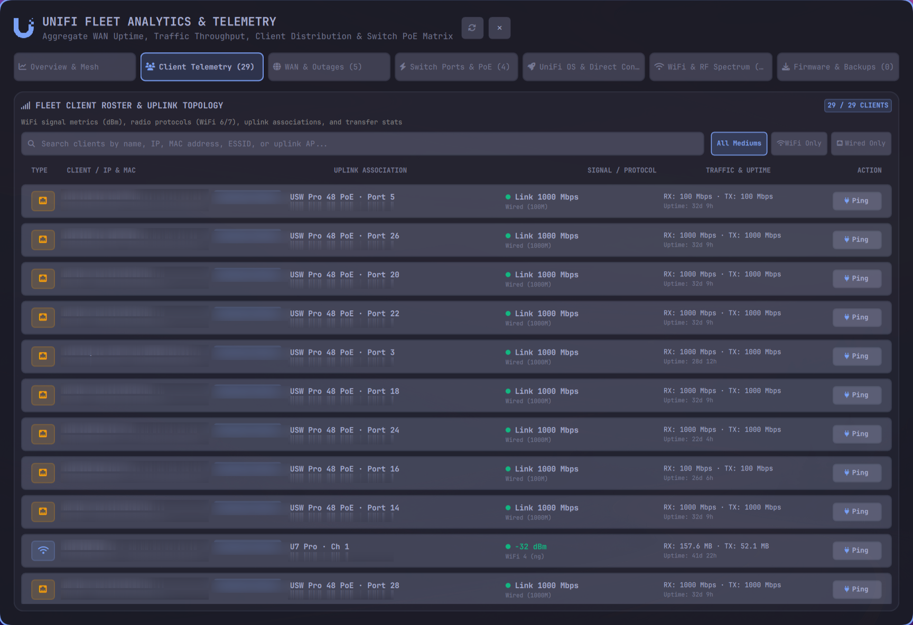

**3. WAN & Outages** – gateway WAN interfaces, link speed, ISP peering/SLA and historical outage timeline.

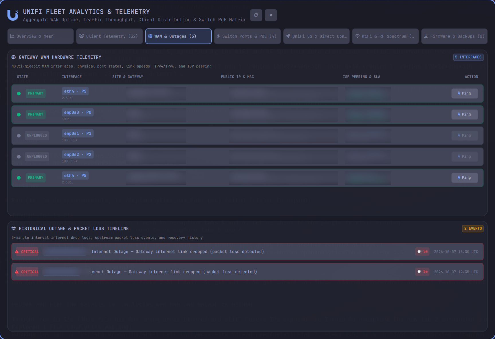

**4. Switch Ports & PoE** – per-switch port strip, PoE budget, two-column port matrix, remote PoE power cycling.

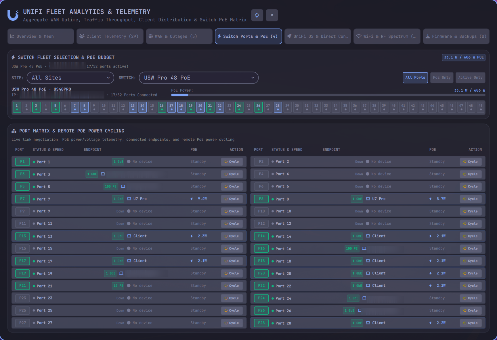

**5. UniFi OS & Direct Connect** – console cards, `*.id.ui.direct` WebRTC P2P access and installed applications.

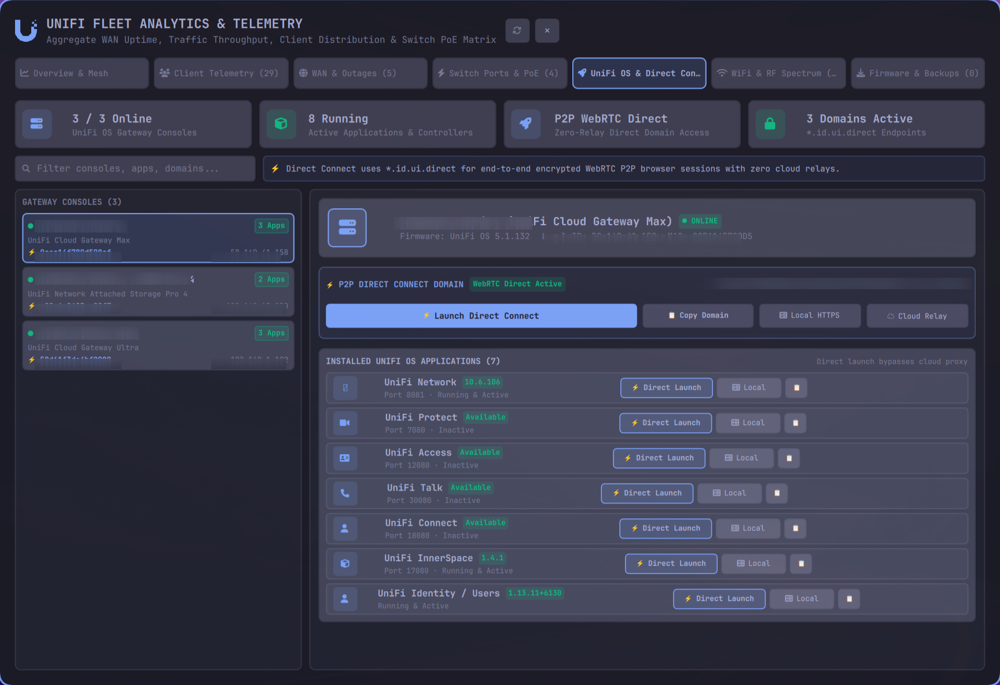

**6. WiFi & RF Spectrum** – WLAN inventory, QR onboarding, per-band congestion, AP radio assignments.

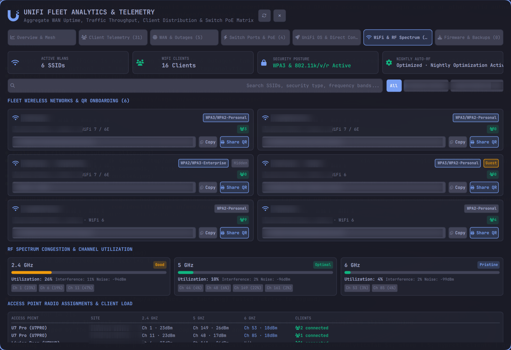

**7. Firmware & Backups** – pending firmware updates, batch deployment, cloud configuration backups.

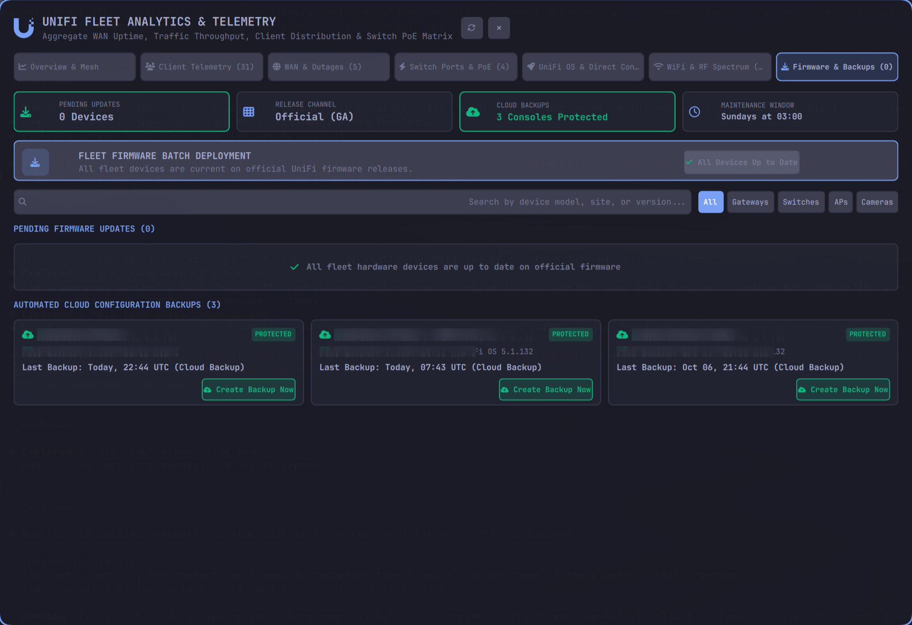

## Features

### Bar widget
- Health-aware UniFi icon with optional multi-dot per-site status indicators.
- Configurable badge: **Alerts Count**, **Fleet Clients**, **Sites Ratio**, **Updates**, or **Off**.
- Adapts to the active Omarchy theme and light/dark mode through dynamic palette variables.

### Overview cockpit
- Header with status pill, last-refresh age, spinner and refresh glow bar; buttons for analytics, settings and refresh.
- Four KPI tiles: Sites, Gateways & Multi-WAN, Network Devices, Clients (Wi-Fi vs. wired).
- **Interactive 3D vector globe** (Natural Earth geometry via [OmaGlobe](https://github.com/zamak/omaglobe)): fast drag-to-rotate, scroll zoom, focus/auto-rotate controls, graticule, atmospheric shading, glowing status beacons and click-to-open site drilldown. SD-WAN links are drawn between sites.
- **Attention Required** list of active incidents.

### Sites and Devices
- Fleet-wide site list with gateway model, ISP, WAN uptime, client counts, and 1-click **SSH** / **Ping** / **Web** actions (opens your preferred terminal).
- Device inventory with filters for Gateways, Switches, APs and Storage.
- Per-site live Network view and, where installed, a Protect tab with cameras and live snapshot refresh.

### Issues
- Persistent issue history (`~/.config/site-thread/issues.json`) with **All / Active / Resolved** filters, resolution timestamps and durations, plus **Clear**.

### Analytics window (7 tabs)
Opened from the header button or `a`/`m`. Includes a refresh button next to close, site filtering (click a site to filter throughput), and consistent evenly-spaced tab buttons. Tab labels show live counts. All data comes from the UniFi API; nothing is placeholder.

### WiFi & RF health
- WLAN inventory with security type, VLAN, WiFi generation, hidden/guest flags and client counts.
- Copy password and **Share QR** onboarding.
- 2.4 / 5 / 6 GHz utilisation, interference, noise and channel distribution; Auto-RF status.
- Access point radio assignments and client load.

### Firmware & lifecycle
- Pending updates by device class, release channel, maintenance window, batch deployment workflow with an empty state when everything is current.
- Automated cloud backup status with **Create Backup Now**.

### Linux desktop & Omarchy integration
- Native desktop notifications (`notify-send`) for site outages and WAN failover, with test button.
- Preferred terminal selection: Default, Ghostty, Kitty, Foot, Alacritty.
- Configurable refresh interval (15s – 5m) and globe auto-rotate.
- Full IPC control for keybindings and scripting (see below).

## Security model

UniFi SiteThread does not ask for or store your UniFi password. Sign-in happens in
your normal browser at `unifi.ui.com`; the plugin uses the official Site Manager
API-key flow. The key travels from the masked field to the local helper over
standard input, is stored by `secret-tool`, and never appears in Omarchy's
`shell.json`, process arguments, or logs.

Cloud requests use normal public TLS verification against `api.ui.com`. In the
optional local-console mode, the connection screen displays the console's
SHA-256 certificate fingerprint and every request pins its public key.

All remote strings are rendered as plain text (defense in depth against markup injection).

Create a dedicated local UniFi user with the minimum permissions needed for
Network viewing and Protect viewing, then create an API key while signed in as
that user.

## Install

```bash
omarchy plugin add https://github.com/larrywcox/omarchy-site-thread.git --enable
```

Local development checkout:

```bash
omarchy plugin add /path/to/site-thread --enable
```

## Dependencies

- `python3`
- `curl`
- `openssl`
- `secret-tool` from `libsecret`, for secure API-key storage
- `wl-paste` from `wl-clipboard`, for the **Paste API key from clipboard** button
- `notify-send` (optional) for desktop notifications

## Connect

1. Click the UniFi SiteThread icon in the bar.
2. Select **Sign in at unifi.ui.com**.
3. In Site Manager, open **Settings → API Keys** and create an API key.
4. Return to UniFi SiteThread, paste the key into the masked field, and select
   **Connect all sites**.

If the usual keyboard shortcut is unavailable inside the bar popup, select
**Paste API key from clipboard** below the masked field. The credential remains
available across logins while your desktop keyring is unlocked.

## Keyboard shortcuts

| Key | Action |
| --- | --- |
| `r` | Refresh |
| `s` | Toggle settings |
| `a` / `m` | Toggle analytics window |
| `w` | Switch tab |
| `Esc` | Close |

## IPC reference

```bash
qs ipc -p /usr/share/omarchy/shell call larrywcox.site-thread <function> [args]
```

| Function | Description |
| --- | --- |
| `open` / `close` / `toggle` | Show, hide or toggle the popup |
| `tab <0-3>` | Open a popup tab (Overview, Sites, Issues, Protect) |
| `openSettings` / `closeSettings` | Settings view |
| `openAnalytics` / `closeAnalytics` / `toggleAnalytics` | Analytics window |
| `openAnalyticsTab <0-6>` | Open a specific analytics tab |
| `filterAnalyticsSite <name>` / `clearAnalyticsSiteFilter` | Site filter |
| `setSitesSubView sites\|devices` | Sites sub-view |
| `rotate <lon>` / `zoomIn` / `zoomOut` / `setGlobeScale <n>` | Globe control |

## Update / Remove

```bash
omarchy plugin update larrywcox.site-thread
omarchy plugin remove larrywcox.site-thread --yes
```

Removing the plugin does not delete the saved API key. To remove it:

```bash
secret-tool clear application site-thread profile default
```

## Development

```bash
python3 -m unittest discover -s tests
```

## Roadmap

- Protect motion-event WebSocket and desktop notifications.
- Event filmstrip and low-latency RTSP video.
- Carefully confirmed client, PTZ, light, siren, relay, and arm-profile actions.
- Side-by-side multi-camera layouts.

Operational actions should use a separate, explicitly privileged credential;
the default monitoring credential should stay read-only.

## License

MIT
